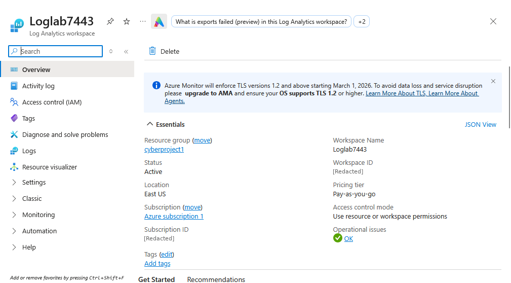
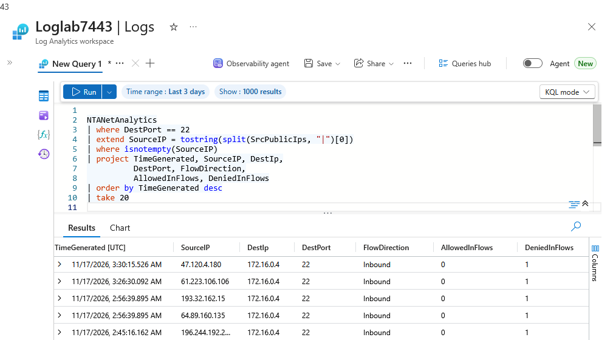
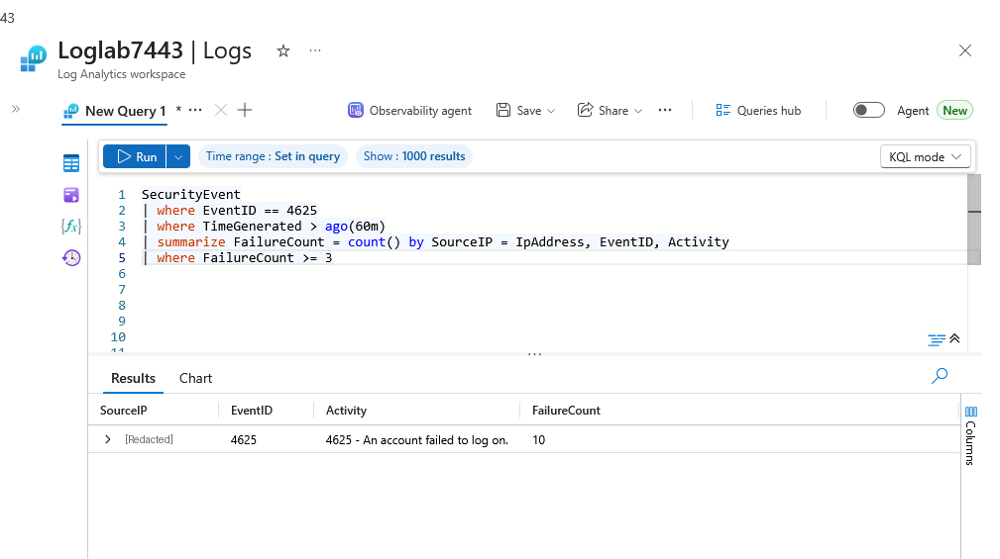

# Azure Microsoft Defender for Endpoint

## Project Overview

This project explores cloud security, identity and access management, endpoint protection, and security operations within a Microsoft Azure environment.

So far, I have gained hands-on experience in creating and managing users in Microsoft Entra ID, implementing Role-Based Access Control (RBAC), and enforcing the Principle of Least Privilege (PoLP).

I have also utilized Azure Log Analytics and Kusto Query Language (KQL) to identify an IP address and leveraged VirusTotal to investigate its reputation and potential malicious activity.

The project will expand to include endpoint detection and response, controlled attack simulations, security alert investigations, authentication activity analysis, and remote endpoint investigations using Microsoft Defender for Endpoint.

---

## Skills Demonstrated

- Identity and Access Management (IAM)
- Microsoft Entra ID
- Role-Based Access Control (RBAC)
- Principle of Least Privilege (PoLP)
- User Provisioning and Access Management
- Kusto Query Language (KQL)
- Azure Log Analytics
- Open-Source Threat Intelligence (OSINT)
- IP Address Reputation Analysis
- Indicator of Compromise (IOC) Investigation

---

## What I Learned

Through this project, I have developed a practical understanding of identity security, access management, and introductory threat investigation within a Microsoft Azure environment.

I learned how to create and manage user accounts in Microsoft Entra ID, assign role-based permissions, and apply the Principle of Least Privilege to minimize unnecessary access to cloud resources.

I also gained experience using Kusto Query Language (KQL) within Azure Log Analytics to identify an IP address and investigate its reputation using VirusTotal.

This investigation strengthened my understanding of how threat intelligence can support security analysts in identifying potentially malicious activity.

---

## Technologies Used

- Microsoft Azure
- Microsoft Entra ID
- Azure Role-Based Access Control (RBAC)
- Azure Log Analytics
- Kusto Query Language (KQL)
- VirusTotal

---

## 1. Identity and Access Management

Created and configured test employee accounts in Microsoft Entra ID to simulate an organizational environment with users from different departments.

The following accounts were provisioned:

- Fahima Abdul — Developer
- Jennifer Halvey — Human Resources (HR)
- Kattie Hoven — Security

The objective was to establish a foundation for identity management, role-based access control, and the implementation of the Principle of Least Privilege.

*Figure 1: Test employee accounts provisioned in Microsoft Entra ID.*

---

### Role-Based Access Control (RBAC) and Principle of Least Privilege

Implemented Azure Role-Based Access Control (RBAC) within the Cyberproject1 resource group to manage employee access based on their organizational responsibilities.

### Role-Based Access Control (RBAC) and Least Privilege

Assigned Azure RBAC roles within the Cyberproject1 resource group based on each employee's responsibilities.

- Fahima Abdul — Contributor
- Jennifer Halvey — Reader
- Kattie Hoven — Security Reader

Restricted permissions to the resource group scope to support the Principle of Least Privilege.

*Figure 2: Azure RBAC role assignments.*

---
## 2. Network Traffic Analysis and Threat Intelligence

Conducted a network traffic investigation using Azure Log Analytics, Kusto Query Language (KQL), and VirusTotal to identify suspicious inbound SSH traffic and assess IP address reputation.

### Log Analytics Workspace

Configured an Azure Log Analytics workspace for querying and analyzing network traffic data.

*Figure 3: Azure Log Analytics workspace.*

### SSH Traffic Investigation Using KQL

Used KQL to filter network traffic targeting SSH (port 22) and identify public source IP addresses.

*Figure 4: KQL query filtering SSH traffic.*

Aggregated network flows by source IP address to identify allowed and denied traffic.

*Figure 5: Analysis of network flows by source IP address.*

### Threat Intelligence Investigation

Investigated the suspicious IP address 193.32.162.15 using VirusTotal. The IP address was flagged as malicious by 15 out of 92 security vendors and associated with SSH brute-force activity and network scanning in threat intelligence reports.

*Figure 6: IP reputation investigation using VirusTotal.*

### Network Security Group (NSG) Review

Reviewed inbound NSG rules to understand existing network access controls and traffic restrictions.

*Figure 7: Azure Network Security Group rules.*

### Investigation Findings

- Identified suspicious inbound traffic targeting SSH.
- Observed denied network flows from suspicious source IP addresses.
- Correlated network traffic findings with external threat intelligence.
- Reviewed existing network security controls.

No successful SSH connection or system compromise was established by this investigation.

---

## 3. Simulated Brute-Force Attack and Failed Authentication Analysis

Simulated a brute-force attack against an Azure Windows Server VM by attempting multiple RDP logins using invalid credentials in a controlled lab environment.

### Failed Authentication Investigation

Queried Windows Security Events using KQL to identify failed authentication attempts (Event ID 4625).

*Figure 8: Windows failed logon events identified using KQL.*

### Threshold-Based Threat Detection

Developed a KQL query to identify source IP addresses associated with three or more failed authentication events within a 60-minute period.

*Figure 9: KQL detection query identifying 10 failed logon events from a single source IP address.*

### Investigation Findings

- Successfully generated and collected failed authentication events.
- Identified 10 failed logon events from a single source IP address.
- Validated threshold-based detection logic using KQL.
- Observed Windows authentication rejecting invalid credentials.

---

---

---
