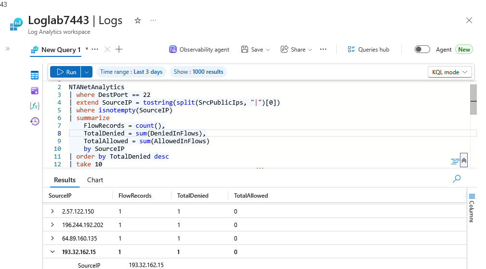
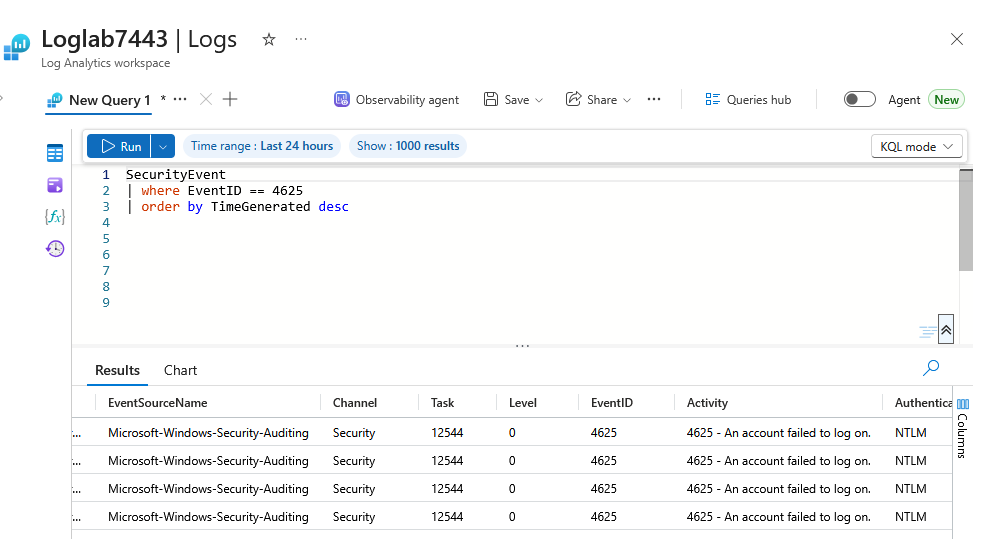
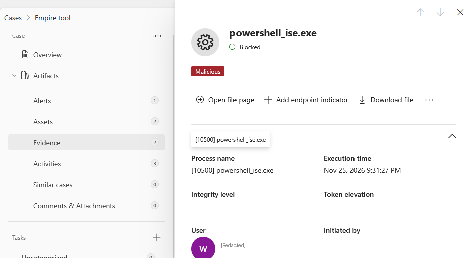
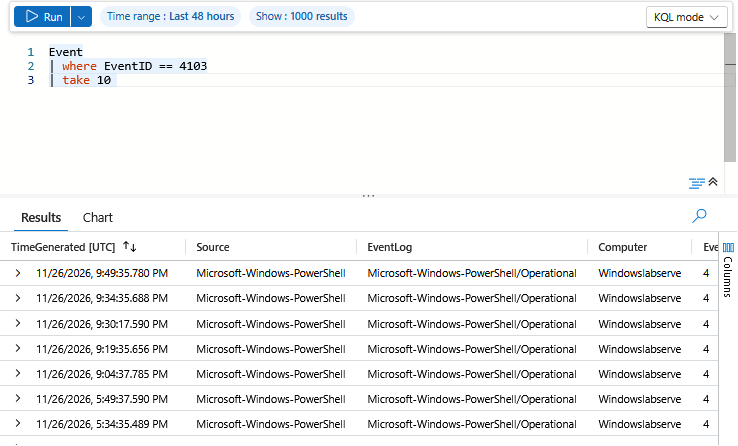

# Azure Microsoft Defender for Endpoint

## Project Overview

This hands-on cybersecurity project demonstrates cloud security, identity and access management, security monitoring, endpoint protection, threat investigation, and incident response within a Microsoft Azure environment.

The project involved configuring identity and access controls, analyzing suspicious network traffic, investigating failed authentication attempts, onboarding a Windows Server virtual machine to Microsoft Defender for Endpoint (MDE), and conducting controlled attack simulations.

Using Azure Log Analytics, Kusto Query Language (KQL), VirusTotal, and Microsoft Defender for Endpoint, I investigated suspicious activity, analyzed security alerts and endpoint telemetry, and performed endpoint containment and remote threat remediation.

All attack simulations and security investigations were conducted within an authorized, controlled lab environment for educational purposes.

---

## Tools and Technologies

| Tool / Technology | Purpose |
|---|---|
| Microsoft Azure | Cloud infrastructure and security resource management |
| Microsoft Entra ID | Identity and user account management |
| Azure Role-Based Access Control (RBAC) | Resource access and permission management |
| Azure Virtual Machines | Windows Server lab environment |
| Azure Network Security Groups (NSGs) | Network access control and traffic filtering |
| Azure Monitor and Log Analytics | Security log collection and analysis |
| Azure Monitor Agent (AMA) | Windows event log collection |
| Microsoft Sentinel | SIEM environment and security monitoring |
| Kusto Query Language (KQL) | Security log querying and analysis |
| Microsoft Defender for Endpoint (MDE) | Endpoint detection, investigation, and response |
| Microsoft Defender Antivirus | Malicious script detection and prevention |
| Microsoft Defender Live Response | Remote endpoint investigation and remediation |
| Windows PowerShell | Endpoint verification and controlled attack simulation |
| Windows Event Logs | Authentication and PowerShell activity analysis |
| VirusTotal | IP address reputation and threat intelligence |
| Remote Desktop Protocol (RDP) | Remote Windows Server access and authentication testing |

---

## Skills Demonstrated

- Identity and Access Management (IAM)
- User provisioning and role-based access management
- Principle of Least Privilege (PoLP)
- Cloud and network security configuration
- Security monitoring and log analysis
- KQL query development and threshold-based detection
- Network traffic analysis
- Threat intelligence and IP reputation analysis
- Failed authentication and brute-force activity investigation
- Endpoint Detection and Response (EDR)
- Security alert and incident investigation
- Process tree and endpoint evidence analysis
- PowerShell attack technique and obfuscation analysis
- Endpoint containment and device isolation
- Remote threat remediation and quarantine verification

---

## Hands-On Labs

1. [Identity and Access Management](#1-identity-and-access-management)
2. [Network Traffic Analysis and Threat Intelligence](#2-network-traffic-analysis-and-threat-intelligence)
3. [Simulated Brute-Force Attack and Failed Authentication Analysis](#3-simulated-brute-force-attack-and-failed-authentication-analysis)
4. [Microsoft Defender for Endpoint Onboarding and Verification](#4-microsoft-defender-for-endpoint-onboarding-and-verification)
5. [Simulated PowerShell Attack and Endpoint Incident Response](#5-simulated-powershell-attack-and-endpoint-incident-response)
6. [Microsoft Defender Live Response and Threat Remediation](#6-microsoft-defender-live-response-and-threat-remediation)

---

## 1. Identity and Access Management

Created and configured test employee accounts in Microsoft Entra ID to simulate an organizational environment with users from different departments.

### User Provisioning

Provisioned three test employee accounts representing Development, Human Resources, and Security departments.

*Figure 1: Test employee accounts provisioned in Microsoft Entra ID.*

### Role-Based Access Control and Least Privilege

Assigned Azure RBAC roles within the Cyberproject1 resource group based on each test employee's organizational responsibilities.

| Test Employee | Department | Assigned Role |
|---|---|---|
| Fahima Abdul | Development | Contributor |
| Jennifer Halvey | Human Resources | Reader |
| Kattie Hoven | Security | Security Reader |

Scoped the role assignments to the resource group rather than granting subscription-wide access, supporting the Principle of Least Privilege.

*Figure 2: Azure RBAC role assignments at the resource group scope.*

### Results

- Provisioned test employee identities in Microsoft Entra ID.
- Assigned role-based permissions according to organizational responsibilities.
- Applied resource group-level access control to limit unnecessary access.

---

## 2. Network Traffic Analysis and Threat Intelligence

Conducted a network traffic investigation using Azure Log Analytics, KQL, and VirusTotal to identify suspicious inbound traffic targeting SSH and assess source IP address reputation.

### Log Analytics Workspace

Configured an Azure Log Analytics workspace for collecting and analyzing security-related telemetry.

*Figure 3: Azure Log Analytics workspace.*

### SSH Traffic Investigation Using KQL

Queried the NTANetAnalytics table to identify network traffic targeting SSH (TCP port 22) and extract public source IP addresses.

*Figure 4: KQL query filtering network traffic targeting SSH.*

Aggregated network flows by source IP address to examine allowed and denied traffic.

*Figure 5: Aggregated network flow analysis by source IP address.*

### Threat Intelligence Investigation

Investigated the suspicious IP address `193.32.162.15` using VirusTotal.

At the time of investigation, 15 out of 92 security vendors flagged the IP address as malicious. Associated threat intelligence also linked the address to SSH brute-force activity and network scanning.

*Figure 6: IP address reputation investigation using VirusTotal.*

### Network Security Group Review

Reviewed inbound Network Security Group (NSG) rules to understand existing network access controls and traffic restrictions.

*Figure 7: Azure Network Security Group inbound rules.*

### Investigation Findings

- Identified suspicious inbound traffic targeting SSH.
- Observed denied network flows from suspicious source IP addresses.
- Enriched network traffic findings with external threat intelligence.
- Reviewed network access controls to assess existing security restrictions.

The investigation identified suspicious traffic but did not establish a successful SSH connection or confirmed system compromise.

---

## 3. Simulated Brute-Force Attack and Failed Authentication Analysis

Simulated repeated RDP authentication attempts using invalid credentials against an Azure Windows Server VM in a controlled lab environment.

The objective was to generate failed authentication events and develop query-based detection logic for potential brute-force activity.

### Failed Authentication Investigation

Queried the SecurityEvent table using KQL to identify Windows failed logon events (Event ID 4625).

*Figure 8: Windows failed logon events identified using KQL.*

### Threshold-Based Threat Detection

Developed a KQL query to identify source IP addresses associated with three or more failed authentication events within a 60-minute period.

The query aggregated failed logon events by source IP address and filtered the results based on the defined threshold.

*Figure 9: KQL detection query identifying 10 failed logon events from a single source IP address.*

### Investigation Findings

- Successfully generated and collected Windows failed authentication events.
- Identified 10 failed logon events associated with a single source IP address.
- Validated threshold-based detection logic using KQL.
- Confirmed that Windows authentication rejected invalid credentials.

The detection was validated through manual KQL query execution.

---

## 4. Microsoft Defender for Endpoint Onboarding and Verification

Onboarded an Azure Windows Server VM to Microsoft Defender for Endpoint (MDE) to establish endpoint security monitoring and response capabilities.

### Endpoint Onboarding

Executed the Microsoft Defender for Endpoint local onboarding script with administrative privileges.

*Figure 10: Successful execution of the MDE onboarding script.*

### Sensor and Onboarding Verification

Used PowerShell to verify the Defender for Endpoint sensor service and confirm the local onboarding status through the Windows Registry.

Verified the following:

- `Get-Service -Name Sense` returned a Running status.
- The Windows Registry returned `OnboardingState = 1`.

*Figure 11: Verification of the running Sense service and local onboarding status.*

### Results

Successfully onboarded the Windows Server VM and verified its local endpoint monitoring configuration.

Subsequent attack simulation and alert investigation confirmed that endpoint security activity was visible in the Microsoft Defender portal.

---

## 5. Simulated PowerShell Attack and Endpoint Incident Response

Conducted an authorized PowerShell attack simulation using a Microsoft-provided training script to evaluate Microsoft Defender for Endpoint's threat detection and prevention capabilities.

### Attack Simulation and Prevention

Attempted to execute an obfuscated PowerShell payload in a controlled lab environment. Microsoft Defender detected malicious script content and blocked its execution.

*Figure 12: Malicious PowerShell script execution blocked by endpoint protection.*

### Attack Technique Analysis

Reviewed the PowerShell attack script to understand the techniques behind the simulated malicious activity.

The script demonstrated:

- Base64 decoding using `FromBase64String`.
- XOR-based deobfuscation using the `-bxor` operator.
- Reconstruction of decoded content in memory.
- Attempted dynamic execution using `Invoke-Expression`.

These techniques can be used by threat actors to conceal malicious payloads and evade basic security inspection.

Analyzing the script strengthened my understanding of how legitimate PowerShell functionality can be abused for malicious purposes.

### Alert and Incident Investigation

Investigated the generated Empire tool detection in the Microsoft Defender portal.

Reviewed the associated alert, process information, evidence, and process tree to understand the detected PowerShell activity.

Microsoft Defender classified the observed activity as malicious and reported a blocked status.

*Figure 13: Microsoft Defender evidence showing malicious PowerShell activity and blocked status.*

### PowerShell Log Analysis Using KQL

Queried the Event table in Azure Log Analytics to retrieve PowerShell module logging events using Event ID 4103.

This verified the collection of PowerShell operational telemetry and demonstrated the use of Windows event logs to support endpoint investigations.

*Figure 14: PowerShell operational telemetry retrieved using KQL.*

### Incident Response and Containment

Practiced endpoint containment by isolating the virtual machine through Microsoft Defender for Endpoint.

After completing the authorized simulation, released the device from isolation to restore normal network connectivity.

### Investigation Findings

- Validated malicious script detection and prevention capabilities.
- Analyzed PowerShell obfuscation and execution techniques.
- Investigated the Empire tool detection and associated evidence.
- Reviewed process information and the process tree.
- Verified PowerShell operational log collection using KQL.
- Practiced endpoint isolation and release from isolation.

No successful execution of the blocked malicious payload was established.

---

## 6. Microsoft Defender Live Response and Threat Remediation

Used Microsoft Defender for Endpoint's Live Response capability to remotely remediate the PowerShell attack script from the simulated security incident.

### Remote File Remediation

Established a Live Response session with the endpoint and executed the `remediate file` command to quarantine the simulated malicious PowerShell script (`AttackScript.ps1`).

### Remediation Verification

Reviewed the remediation output to confirm the following:

- Remediation status: Quarantined
- Remediation state: Finished
- Error HRESULT: 0

Used the `dir` command to verify that the script was no longer present in its original directory.

*Figure 15: Successful file quarantine and remediation verification using Microsoft Defender Live Response.*

### Investigation Findings

- Established a remote Live Response session.
- Performed manual file remediation.
- Successfully quarantined the simulated malicious PowerShell script.
- Verified the remediation status and removal from the original file location.

---

## What I Learned

Through this project, I developed practical experience across cloud security, identity and access management, security monitoring, endpoint protection, threat investigation, and incident response.

I strengthened my understanding of how identity and network access controls help reduce unauthorized access, and how security telemetry can be analyzed using KQL to identify suspicious patterns.

Investigating suspicious network traffic and authentication events demonstrated the importance of correlating security logs with external threat intelligence while distinguishing suspicious activity from confirmed compromise.

The PowerShell attack simulation provided insight into script obfuscation techniques, endpoint detection capabilities, security alert investigation, and process analysis.

I also gained hands-on experience with endpoint containment and remote threat remediation using Microsoft Defender for Endpoint, including device isolation, file quarantine, and remediation verification.

Overall, this project strengthened my analytical thinking, technical investigation skills, and understanding of how security controls, monitoring, detection, and response work together within a cloud security environment.
